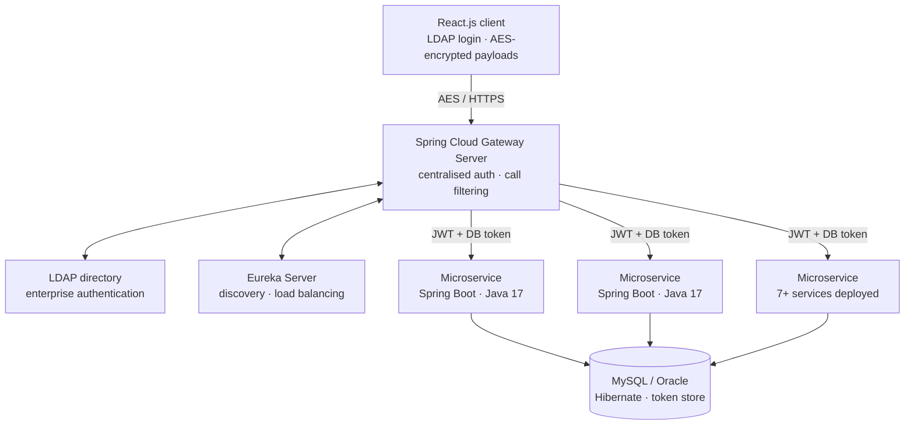

<h1 align="center">Onkar K. Pawar</h1>

  <b>Java Backend Developer</b> &nbsp;·&nbsp; Senior Executive @ IDBI Intech &nbsp;·&nbsp; Thane, India

  Building secure &amp; scalable microservices with strong foundations in performance and security.

  
  
  
  

---

## About

Java Backend Developer with **4+ years** designing, developing and maintaining scalable backend
applications and microservices using **Java** and **Spring Boot**. I work on secure, high-availability
enterprise systems — improving application performance through microservices architecture and Spring
Cloud Gateway, and strengthening security via AES encryption, LDAP, and JWT-based authentication and
authorization. Comfortable across Docker, CI/CD pipelines and cross-functional Agile delivery.

> [!NOTE]
> **Most of my engineering work lives in private enterprise repositories.** The public repos on this
> profile are a learning and experimentation space — clones, course code and side projects, mostly in
> JavaScript and Python. They are not representative of what I do professionally. The sections below
> describe the enterprise work at a level I can share publicly.

---

## What I actually build

Enterprise backend platforms — described at a professional level only. No client data, credentials,
endpoints, schemas or proprietary code.

| Where | Role | Period | What I build |
| :--- | :--- | :--- | :--- |
| **IDBI Intech** | Senior Executive | Oct 2024 – Present | A secure microservices platform built from scratch: React.js frontend with LDAP login, Spring Cloud Gateway for centralised auth and call filtering, Eureka service discovery, and end-to-end AES-encrypted communication across 7+ Spring Boot services. |
| **Nexstep Infotech** *(Expenzing)* | Software Engineer | Jan 2022 – Aug 2024 | Procure-to-Pay and Travel &amp; Expense mobile applications — multi-attachment support, OCR on invoices and expense vouchers, map functionality, UI/UX upgrades, plus VAPT remediation across the stack. |
| **Tritorc** | IT Technical Engineer | May 2021 – Sept 2021 | Network and desktop infrastructure across Windows Server and Linux — Active Directory, DNS, DHCP, TCP/IP and VPN for 30+ systems. |

### Measured impact

| | | |
| :--- | :--- | :--- |
| **70%** application performance improvement | **40%** enterprise security compliance increase | **30%** code efficiency improvement |
| **7+** microservices architected &amp; deployed | **20%** reduction in repetitive coding effort | **15%** reduction in system downtime |

---

## Architecture I work with

The secure microservices platform I built at IDBI Intech, at a shareable level:

<b>How the security layers fit together</b>

 

| Layer | Mechanism |
| :--- | :--- |
| Client → Gateway | AES encryption with PKCS7 padding on request and response bodies |
| Authentication | LDAP directory login, handled centrally at the gateway |
| Gateway → Services | Multi-level JWT plus database-driven token authentication |
| Service → Service | End-to-end AES-encrypted data exchange |
| Discovery | Eureka for service registration, discovery and load balancing |
| Delivery | Docker images deployed through CI/CD pipelines |

Earlier, at Expenzing, I worked through VAPT findings on the mobile stack — SSL pinning, encrypted
body transmission, session handling, single-response services, multiple-login prevention, broken
authentication prevention and rooted-device blocking.

---

## Tech stack

**Languages &amp; core**

**Frameworks**

**Security**

**Data &amp; servers**

**DevOps &amp; tooling**

---

## Currently exploring

Happy to collaborate on **software development and Spring Boot projects**, and always glad to talk
through **software engineering and application security fundamentals**.

---

## Certifications

| Certification | Issuer | Date |
| :--- | :--- | :--- |
| Master Microservices with Spring Boot, Docker, Kubernetes | Udemy | Jun 2024 |
| Complete React Developer *(Redux, Hooks, GraphQL)* | Udemy | Nov 2023 |
| Java Design Patterns &amp; SOLID Design Principles | Udemy | Oct 2023 |
| Multiplatform Mobile App Development With React Native | Coursera | Aug 2023 |

- **Award** — *Going Beyond Call of Duty*, issued by the CEO, Expenzing (2023)
- **Education** — Bachelor of Computer Science, Bharati Vidyapeeth College of Engineering (2016 – 2020)

---

## Activity

  

> [!TIP]
> The contribution graph on my profile includes private contributions, so it reflects the enterprise
> work described above rather than just the public repositories below it.

---

## Connect

[**Portfolio**](https://orov2.github.io) · [**LinkedIn**](https://www.linkedin.com/in/onkar-pawar-software-engineer/) · [**Stack Overflow**](https://stackoverflow.com/users/14092691/onkar-pawar) · [**Quora**](https://www.quora.com/profile/Onkar-Pawar-18) · [onkarpawar58@gmail.com](mailto:onkarpawar58@gmail.com)
